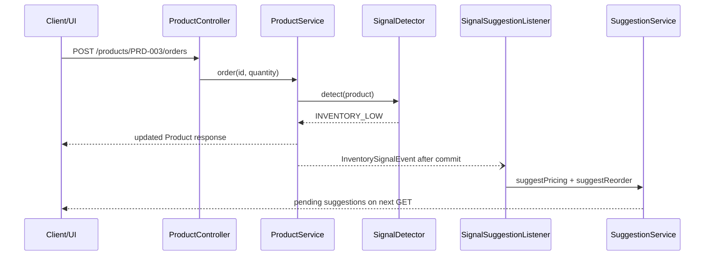

# StockPulse

StockPulse is a Spring Boot commerce advisor with a React dashboard. Product mutations run synchronously. Recommendation generation runs asynchronously after commit. Prices and simulated inbound stock change only after an explicit accept decision.

## How to run and where to open things

Requirements: Java 17, Maven, Node.js/npm. The repository does not include a Maven wrapper.

| URL | Purpose |
|---|---|
| `http://localhost:5173` | Vite React dashboard, using the default Vite port. |
| `http://localhost:8080` | Spring Boot REST base URL. |
| `http://localhost:8080/swagger-ui/index.html` | Swagger UI from the Springdoc dependency. |
| `http://localhost:8080/admin/strategy` | Read or change the active advisor strategy. |
| `http://localhost:8080/admin/llm-health` | Run the small LLM health call. |
| `http://localhost:8080/actuator/health` | Spring Boot Actuator health endpoint. |

PowerShell:

```powershell
cd C:\Users\zycus\Desktop\Zycus-Hackathon-Project\backend
mvn spring-boot:run
# separate terminal
cd C:\Users\zycus\Desktop\Zycus-Hackathon-Project\frontend
npm install
$env:VITE_API_URL = "http://localhost:8080"
npm run dev
```

bash:

```bash
cd /path/to/Zycus-Hackathon-Project/backend && mvn spring-boot:run
# separate terminal
cd /path/to/Zycus-Hackathon-Project/frontend
npm install
VITE_API_URL=http://localhost:8080 npm run dev
```

The frontend defaults to `http://localhost:8080` when `VITE_API_URL` is unset. The backend database is `./data/stockpulse.db` relative to the backend process.

## Flows

### a. Create/list products (filters)

**Trigger:** Create a product or load/filter the dashboard.

**Path:** `POST /products` -> `ProductController.create` -> `ProductService.create` -> `ProductRepository.save`. `GET /products` -> `ProductController.list` -> `ProductService.list`, filtering optional `status` and `category` -> `ProductDtos.Response` list.

**UI:** Products load on startup and every four seconds. Use the category and status selects above the product cards.

**PowerShell:**

```powershell
$body = @{ id='PRD-NEW'; sku='SKU-NEW'; name='Demo Product'; category='HOME'; currentPrice=19.99; stockLevel=20; reorderThreshold=5; demandVelocity=1 } | ConvertTo-Json
Invoke-RestMethod http://localhost:8080/products -Method Post -ContentType 'application/json' -Body $body
Invoke-RestMethod 'http://localhost:8080/products?category=HOME&status=ACTIVE'
```

**See:** A product response and filtered cards, or the dashboard empty state.

### b. Simulate sale / stock update (sync part vs async part)

**Trigger:** Dashboard `Simulate sale`, or `PATCH /products/{id}/stock`.

**Path:** `POST /products/{id}/orders` -> `ProductController.order` -> `ProductService.order`. It decrements stock, increments velocity, updates immediate status, and calls `SignalDetector.detect`. Stock update follows `ProductController.stock` -> `ProductService.updateStock`. Signals are handled only after commit by `SignalSuggestionListener` on `signalExecutor`.

**Sync vs async:** The product mutation and HTTP response are synchronous. Recommendation generation and persistence are asynchronous.

**UI:** Enter a quantity and click `Simulate sale`. The current UI has no stock-adjust input; use the API for stock adjustment.

**PowerShell:**

```powershell
Invoke-RestMethod http://localhost:8080/products/PRD-003/orders -Method Post -ContentType 'application/json' -Body '{"quantity":1}'
Invoke-RestMethod http://localhost:8080/products/PRD-003/stock -Method Patch -ContentType 'application/json' -Body '{"stockLevel":10}'
```

**See:** The product response changes immediately. Suggestions appear after async processing.

### c. Inventory-low loop (PRD-003)

**Trigger:** `stockLevel < reorderThreshold`. Seed PRD-003 has stock `8` and threshold `15`.

**Path:** `POST /products/PRD-003/orders` -> `ProductController.order` -> `ProductService.order` -> `SignalDetector.detect` returns `INVENTORY_LOW` -> `InventorySignalEvent` -> after-commit `SignalSuggestionListener.onSignal` -> `SuggestionService.suggestPricing` and `suggestReorder`. Pricing creation moves the product to `PRICE_REVIEW_PENDING`.

**UI:** Click `Simulate sale` on PRD-003 and wait for the four-second poll.

**PowerShell:**

```powershell
Invoke-RestMethod http://localhost:8080/products/PRD-003/orders -Method Post -ContentType 'application/json' -Body '{"quantity":1}'
Start-Sleep -Seconds 5
Invoke-RestMethod 'http://localhost:8080/pricing-suggestions?productId=PRD-003&status=PENDING'
Invoke-RestMethod 'http://localhost:8080/reorder-suggestions?productId=PRD-003&status=PENDING'
```

**See:** Separate pending pricing and reorder suggestions with `triggerReason=INVENTORY_LOW`.



### d. Demand-spike loop (PRD-008)

**Trigger:** Current velocity is greater than `3.0` times the average of other same-category products by default.

**Path:** The path is the same as flow c, but `SignalDetector.detect` returns `DEMAND_SPIKE`; saved suggestions carry `triggerReason=DEMAND_SPIKE`.

**UI:** Enter a large quantity on PRD-008 and click `Simulate sale`.

**PowerShell:**

```powershell
Invoke-RestMethod http://localhost:8080/products/PRD-008/orders -Method Post -ContentType 'application/json' -Body '{"quantity":7}'
Start-Sleep -Seconds 5
Invoke-RestMethod 'http://localhost:8080/pricing-suggestions?productId=PRD-008&status=PENDING'
Invoke-RestMethod 'http://localhost:8080/reorder-suggestions?productId=PRD-008&status=PENDING'
```

**See:** Pricing and reorder suggestions labelled `DEMAND_SPIKE`.

### e. On-demand pricing and reorder suggestions

**Trigger:** Dashboard `Price idea` or `Reorder idea`.

**Path:** `POST /products/{id}/suggest-pricing` -> `SuggestionController.pricing` -> `SuggestionService.suggestPricing` with `MANUAL`. `POST /products/{id}/suggest-reorder` follows the corresponding reorder methods.

**UI:** Click either button on a product card.

**PowerShell:**

```powershell
Invoke-RestMethod http://localhost:8080/products/PRD-003/suggest-pricing -Method Post
Invoke-RestMethod http://localhost:8080/products/PRD-003/suggest-reorder -Method Post
```

**See:** A `MANUAL` suggestion. A pending duplicate for the same product, type, and trigger is returned rather than inserted again.

### f. Accept / reject suggestion

**Trigger:** Dashboard `Accept`/`Reject`, or a PATCH request.

**Path:** `PATCH /pricing-suggestions/{id}` -> `SuggestionController.decidePricing` -> `SuggestionService.decidePricing`. Accept updates `currentPrice`, supersedes other pending pricing suggestions, and recomputes status. Reject does not change price. Reorder decisions follow the same path; accepting adds the recommended quantity to stock, supersedes other pending reorders, and can move `OUT_OF_STOCK` to `ACTIVE`.

**UI:** Click a decision button on a pending suggestion.

**PowerShell:**

```powershell
$pending = Invoke-RestMethod 'http://localhost:8080/pricing-suggestions?productId=PRD-003&status=PENDING'
$id = $pending[0].id
Invoke-RestMethod "http://localhost:8080/pricing-suggestions/$id" -Method Patch -ContentType 'application/json' -Body '{"status":"ACCEPTED"}'
Invoke-RestMethod http://localhost:8080/products/PRD-003
```

**See:** Accepted pricing changes price; accepted reorder changes stock; other pending same-type suggestions become `SUPERSEDED`. Optimistic-lock conflicts return HTTP 409 ProblemDetail.

### g. Switching strategy at runtime

**Trigger:** Dashboard strategy select or `PUT /admin/strategy`.

**Path:** `StrategyController.put` validates through `ActiveAdvisorHolder` and `AdvisorRegistry`, then updates its `AtomicReference`.

**UI:** Choose `rule-based` or `ai`; the selection is sent immediately.

**PowerShell:**

```powershell
Invoke-RestMethod http://localhost:8080/admin/strategy
Invoke-RestMethod http://localhost:8080/admin/strategy -Method Put -ContentType 'application/json' -Body '{"active":"ai"}'
Invoke-RestMethod http://localhost:8080/admin/strategy -Method Put -ContentType 'application/json' -Body '{"active":"rule-based"}'
```

**See:** A response with `active` and `available`. Unknown names return HTTP 400. Runtime changes reset on restart unless configured by environment.

### h. AI failure and fallback

**Trigger:** AI mode is active and the gateway fails, times out, returns malformed JSON, or fails validation.

**Path:** `AiAdvisor` uses `PromptTemplateService`, calls `LlmClient`/`LLMGateway`, parses through `RecommendationParser`, validates, and returns AI. Runtime failures invoke `RuleBasedAdvisor` independently.

**UI:** Source chips show `AI`, `Rule-based`, or `Fallback`. Reasoning is shown; `fallbackReason` is in the REST response.

**PowerShell:**

```powershell
Invoke-RestMethod http://localhost:8080/admin/strategy -Method Put -ContentType 'application/json' -Body '{"active":"ai"}'
Invoke-RestMethod http://localhost:8080/products/PRD-003/suggest-pricing -Method Post
```

**See:** On failure, `source` is `AI_FALLBACK_RULE_BASED`, reasoning starts with `AI fallback:`, and `fallbackReason` contains the safe reason.

## Where is what

| Package/folder | Responsibility | Key classes/files |
|---|---|---|
| `backend/.../product` | Product REST, mutations, lifecycle | `ProductController`, `ProductService`, `Product`, `ProductDtos`, `ProductStateMachine` |
| `backend/.../suggestion` | Suggestion REST, persistence, decisions | `SuggestionController`, `SuggestionService`, suggestion entities/repositories |
| `backend/.../advisor` | Contract and runtime selection | `CommerceAdvisor`, `RuleBasedAdvisor`, `ActiveAdvisorHolder`, `AdvisorRegistry` |
| `backend/.../ai` | AI advisor, gateway, health, parsing | `AiAdvisor`, `LLMGateway`, `LlmClient`, `LlmHealthController`, `RecommendationParser` |
| `backend/src/main/resources/prompts` | Six prompt templates | `pricing-*.txt`, `reorder-*.txt` |
| `backend/.../signal` | Detection and async listener | `SignalDetector`, `InventorySignalEvent`, `SignalSuggestionListener` |
| `backend/.../config` | Async and SQLite configuration | `AsyncConfig`, `SqlitePragmaInitializer` |
| `backend/.../common` | Problem details | `ApiExceptionHandler` |
| `backend/src/main/resources` | Config and seed | `application.yml`, `data.sql` |
| `backend/src/test/java` | Unit, persistence, integration tests | `RuleBasedAdvisorTest`, `AiAdvisorTest`, `Phase4IntegrationTest`, `SqlitePersistenceTest` |
| `frontend/src` | React dashboard | `main.jsx`, `style.css` |
| `README.md`, `ADR.md`, `docs` | Documentation and API examples | `docs/api.http`, `docs/WALKTHROUGH.md` |

## Using the AI part

### AI mode in 5 lines

1. `AiAdvisor` maps type and trigger to a prompt template.
2. `LLMGateway` sends an OpenAI-compatible chat completion request.
3. `RecommendationParser` removes think blocks/fences and extracts JSON.
4. Fields are validated and confidence is clamped.
5. Valid output is `AI`; any failure independently uses rules as fallback.

### Setup

| Variable | Default | Required? |
|---|---|---|
| `LLM_API_KEY` | empty | Required for real AI calls; not required for rule-based mode. |
| `LLM_PROVIDER` | `openai-compatible` | No |
| `LLM_MODEL` | `qwen-cursor` | No |
| `LLM_BASE_URL` | `https://litellm-qc.zycus.net` | No |
| `LLM_COOKIE_ENABLED` | `false` | No |
| `LLM_COOKIE` | empty | No |
| `LLM_PRODUCT_HEADER` | empty | No |
| `STOCKPULSE_ADVISOR_ACTIVE` | automatic | No; `ai` or `rule-based`. |
| `STOCKPULSE_DEMAND_SPIKE_MULTIPLIER` | `3.0` | No |

PowerShell:

```powershell
$env:LLM_API_KEY = '<your-key>'
$env:LLM_BASE_URL = 'https://example.invalid'
$env:LLM_MODEL = '<your-model>'
$env:STOCKPULSE_ADVISOR_ACTIVE = 'ai'
cd backend
mvn spring-boot:run
```

bash:

```bash
export LLM_API_KEY='<your-key>'
export LLM_BASE_URL='https://example.invalid'
export LLM_MODEL='<your-model>'
export STOCKPULSE_ADVISOR_ACTIVE='ai'
cd backend
mvn spring-boot:run
```

Without a non-empty key, automatic startup selects rule-based mode. Set variables in the same terminal that starts the backend.

### Check it

The following responses are examples, not live output.

```powershell
Invoke-RestMethod http://localhost:8080/admin/llm-health
```

Example response: `{"status":"ok","reason":"test call succeeded"}`.

```powershell
Invoke-RestMethod http://localhost:8080/admin/strategy -Method Put -ContentType 'application/json' -Body '{"active":"ai"}'
Invoke-RestMethod http://localhost:8080/products/PRD-003/suggest-pricing -Method Post
```

Example strategy response: `{"active":"ai","available":["rule-based","ai"]}`.

Example suggestion response: `{"id":"...","productId":"PRD-003","recommendedPrice":27.49,"status":"PENDING","triggerReason":"MANUAL","source":"AI","fallbackReason":null}`.

`RULE_BASED` means rules produced the result. `AI` means the LLM response was parsed and validated. `AI_FALLBACK_RULE_BASED` means AI failed and rules produced the result. `fallbackReason` explains the failure and is otherwise `null`.

### Prompts and validation

Prompts live in `backend/src/main/resources/prompts`. `PromptTemplateService` maps type and trigger to files such as `pricing-inventory-low.txt`. Edit the resource, preserve the expected JSON contract, and rebuild/restart.

Pricing validation accepts `0.5x` through `2x` of current price and checks direction consistency. AI reorder quantity is capped at `reorderThreshold * 20`. Confidence is clamped to `0.0` through `1.0`. Reasoning is required and capped at 2000 characters.

### AI troubleshooting

| Symptom | Action |
|---|---|
| 401/403 | Check gateway permissions and the key without printing it. |
| Timeout | Check `LLM_BASE_URL`; connect timeout is 3s and read timeout is 20s. |
| Invalid JSON | Inspect `fallbackReason`; parser cleanup and rule fallback should keep the request usable. |
| Strategy stays rule-based | Set a non-empty `LLM_API_KEY` and `STOCKPULSE_ADVISOR_ACTIVE=ai` in the backend terminal, then restart. |
| Key not picked up | Set variables in the same terminal that starts `mvn spring-boot:run`. |

## Troubleshooting

| Problem | Fix |
|---|---|
| Port 8080 is busy | Stop the process using 8080 or configure the Spring server port; update `VITE_API_URL` to match. |
| Wrong Java version | Run `java -version`; this project compiles for Java 17. |
| SQLite data folder error | Start from `backend`, or ensure its `data` folder can be created. `StockPulseApplication` creates it at startup. |
| CORS error | No CORS mapping is present in the inspected Spring Boot source. Use same-origin/proxy deployment or add explicit Spring CORS configuration. |
| No suggestions yet | Async processing is after commit. Wait for the four-second dashboard poll, then query the suggestion endpoints. |

Backend tests:

```powershell
mvn -f backend/pom.xml test -Dspring.profiles.active=sqlite
```

```bash
mvn -f backend/pom.xml test -Dspring.profiles.active=sqlite
```

Frontend build:

```powershell
npm run build --prefix frontend
```

```bash
npm --prefix frontend run build
```