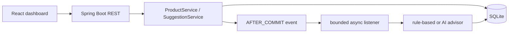
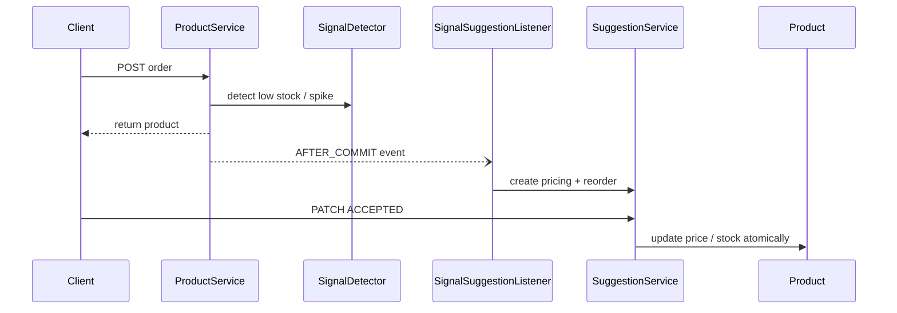

# StockPulse

StockPulse is a Spring Boot commerce advisor: stock and order mutations emit signals, advisors produce pricing/reorder suggestions, and only explicit approval changes price or simulated inbound stock.





## Quickstart

Requirements: Java 17, Maven, Node 18+.

```powershell
cd backend
mvn spring-boot:run
# separate terminal
cd frontend
npm install
npm run dev
```

Open the Vite URL. `VITE_API_URL` defaults to `http://localhost:8080`; copy `.env.example` for local overrides. LLM credentials are optional and must never be committed.

## Demo and API

Use PRD-003 for `INVENTORY_LOW`: post an order, wait five seconds, list pending suggestions, accept pricing, then fetch the product. Use PRD-008 and a larger order for `DEMAND_SPIKE`. Products use `GET /products`, `POST /products/{id}/orders`, and `PATCH /products/{id}/stock`. Suggestions use `/pricing-suggestions`, `/reorder-suggestions`, and their PATCH decision endpoints. Administration uses `GET|PUT /admin/strategy` and `GET /admin/llm-health`. See `docs/api.http`.

| Variable | Default | Purpose |
|---|---|---|
| `LLM_API_KEY` | empty | OpenAI-compatible credential |
| `LLM_BASE_URL` | configured gateway | LLM endpoint |
| `STOCKPULSE_ADVISOR_ACTIVE` | automatic | `ai` or `rule-based` |
| `STOCKPULSE_DEMAND_SPIKE_MULTIPLIER` | `3.0` | spike threshold |
| `VITE_API_URL` | `http://localhost:8080` | frontend API base |

Commerce writes live in Spring Boot services; the active advisor switches atomically; after-commit events avoid recommendations for rolled-back mutations; pending checks and unique dedupe keys make signals idempotent; SQLite uses a busy timeout and bounded executor. Sprint 2 seams include costs, margins, suppliers, and PostgreSQL. Sprint 3 could add streaming explanations, auth, audit, and multi-tenant policies.